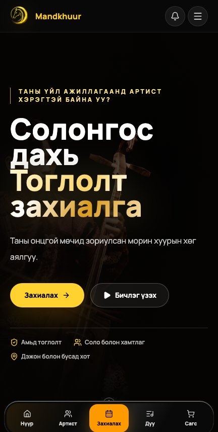
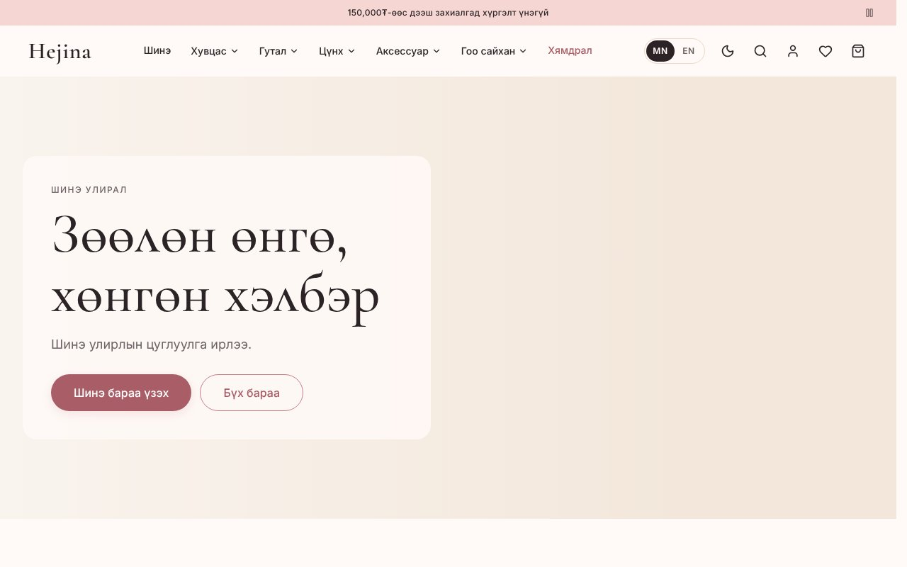
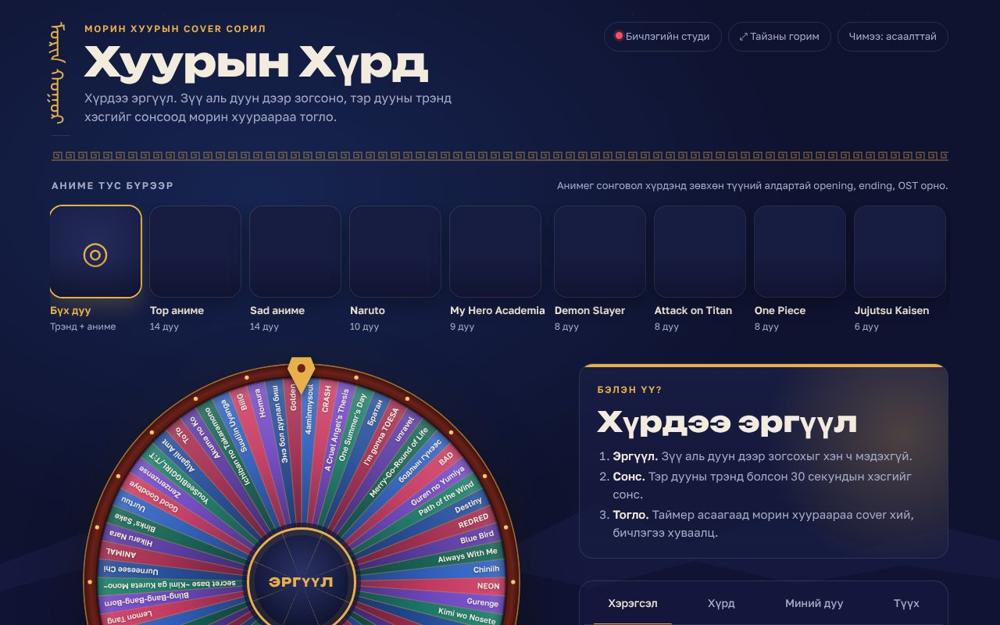

  

  
  
  
  

---

### 🙋 About me

I'm a software engineering student from Mongolia, living in South Korea. I like taking an idea from a Figma frame all the way to a working app, and I'm proud to bring Mongolian traditional music into the digital world.

- 🎻 Building **Mandkhuur**, a website and app for booking Mongolian traditional musicians in Korea
- 🛍️ Built **Hejina**, an online fashion & beauty shop with QPay payments
- 🎡 Made **Хуурын Хүрд**, a morin khuur cover challenge game
- 🎨 Figma → Flutter is my favourite workflow
- 🔌 I also enjoy hardware: Arduino, sensors and servo motors
- 🌱 Currently learning: AI agents, Supabase, shipping an iOS app
- 💬 Ask me about: Flutter, frontend, UI/UX

---

### 🌟 Featured projects

<table>
<tr>
<td width="50%" valign="top">

#### 🎻 Mandkhuur · Website
**Book Mongolian traditional performers in Korea.**
Live morin khuur, khöömii and dance for weddings, parties and events, with artist profiles, ensembles, lessons and an admin dashboard.

🔗 [mandkhuur.com](https://mandkhuur.com)

     

- Booking flow with date and time picker
- Supabase auth, admin dashboard, web push
- Kakao Pay / Kakao Map integration

</td>
<td width="50%" align="center">

</td>
</tr>

<tr>
<td colspan="2">

#### 📱 Mandkhuur · iOS & Android app
The same booking experience as a native mobile app, designed in Figma and built with Flutter.

   

Home with a weekly calendar · browse artists by instrument · artist profiles with price and rating · step-by-step booking · my bookings · dark mode and language settings

</td>
</tr>

<tr>
<td colspan="2">

#### 🛍️ Hejina · Online shop
**Women's fashion and beauty store for Mongolia.** Bilingual (MN / EN), prices in ₮, payment by QPay or cash on delivery.

     

- Catalog, search, wishlist, cart, checkout and order tracking
- Reviews, customer accounts and a full admin panel
- Postgres with Row Level Security, Edge Functions for payments, prerendered pages for SEO
- Automated tests for payments (idempotency, last-unit race) and access rules

</td>
</tr>

<tr>
<td colspan="2">

#### 🎡 Хуурын Хүрд · Khuuriin Khurd
**A spin-the-wheel morin khuur cover challenge.** Spin the wheel, hear the trending 30 seconds of the song it lands on, then play it on your morin khuur.

   

- Song wheels for Mongolian hits, K-pop, anime OST, plus wheels for Naruto, Demon Slayer, One Piece and more
- In-browser recording studio (camera + mic, 9:16 / 1:1 / 16:9, trim and share)
- Stage mode, guessing mode, daily challenge and 1080×1920 story cards
- Built-in tuner (F / B♭) and metronome for khuur players

</td>
</tr>
</table>

<b>🧪 Smaller projects</b> · all school work lives in <a href="https://github.com/hajunaa/school-project">school-project</a>

| | Project | What I built |
|---|---|---|
| 💌 | **[birthday_invite](https://github.com/hajunaa/birthday_invite)** | Animated envelope party invitation that opens into a letter (HTML/CSS/JS) |
| 🚗 | **[SWproject2_carparking](https://github.com/hajunaa/school-project/tree/main/SWproject2_carparking)** | Smart parking gate: ultrasonic sensor + servo with sigmoid / sine easing (Arduino) |
| 📈 | **[SWproject_curvefiting](https://github.com/hajunaa/school-project/tree/main/SWproject_curvefiting)** | IR distance sensor calibration with polynomial curve fitting (Arduino) |
| 📡 | **[SWporject17_14](https://github.com/hajunaa/school-project/tree/main/SWporject17_14)** | IR sensor + servo control with an EMA filter (Arduino) |

---

### 🛠️ Tech stack

  

  

---

### 📊 GitHub stats

  
  

  

  <picture>
    <source media="(prefers-color-scheme: dark)" srcset="https://raw.githubusercontent.com/hajunaa/hajunaa/output/snake-dark.svg" />
    
  </picture>

  

