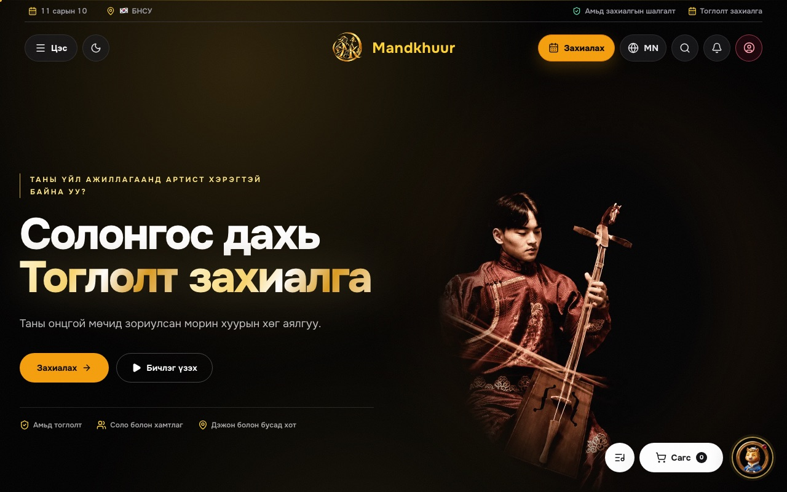

<picture>
  <source media="(prefers-color-scheme: dark)" srcset="assets/hero-dark.svg" />
  
</picture>

  <a href="https://mandkhuur.com"><b>mandkhuur.com</b></a>
  &nbsp;·&nbsp;
  <a href="mailto:mandahk0914@gmail.com">Email</a>
  &nbsp;·&nbsp;
  <a href="https://instagram.com/fav__m">Instagram</a>
  &nbsp;·&nbsp;
  <a href="https://facebook.com/mandakhbayar.uuganbayar">Facebook</a>

I'm a software engineering student from Mongolia, living in South Korea. I like taking an idea from a Figma frame all the way to a working product, and most of what I build brings Mongolian traditional music online.

<table>
  <tr>
    <th width="33%" align="left">Building</th>
    <th width="33%" align="left">Learning</th>
    <th width="34%" align="left">Ask me about</th>
  </tr>
  <tr>
    <td valign="top">Mandkhuur for iOS and Android</td>
    <td valign="top">AI agents, Supabase, shipping to the App Store</td>
    <td valign="top">Flutter, frontend, UI/UX</td>
  </tr>
</table>

## Selected work

<table>
  <tr>
    <td width="50%" valign="top">
      
      <h3>Mandkhuur · Web</h3>
      
Book Mongolian traditional performers in Korea: live morin khuur, khöömii and dance for weddings, parties and events.

      
<code>React</code> <code>TypeScript</code> <code>Tailwind</code> <code>Supabase</code> <code>Three.js</code>

      
<a href="https://mandkhuur.com"><b>Visit mandkhuur.com →</b></a>

    </td>
    <td width="50%" valign="top">
      
      <h3>Mandkhuur · App</h3>
      
The same booking experience as a native mobile app, designed in Figma and built with Flutter.

      
<code>Flutter</code> <code>Dart</code> <code>Figma</code> <code>iOS</code> <code>Android</code>

      
<a href="assets/mandkhuur-preview.jpg"><b>See all six screens →</b></a>

    </td>
  </tr>
  <tr>
    <td width="50%" valign="top">
      
      <h3>Hejina · Online shop</h3>
      
Women's fashion and beauty store for Mongolia. Bilingual (MN / EN), prices in ₮, payment by QPay or cash on delivery.

      
<code>React 19</code> <code>TypeScript</code> <code>Supabase</code> <code>QPay</code> <code>Playwright</code>

    </td>
    <td width="50%" valign="top">
      
      <h3>Хуурын Хүрд · Khuuriin Khurd</h3>
      
A spin-the-wheel morin khuur cover challenge. Spin, hear the trending 30 seconds of the song it lands on, then play it.

      
<code>JavaScript</code> <code>Vite</code> <code>Canvas</code> <code>Web Audio</code>

    </td>
  </tr>
</table>

<b>Mandkhuur</b> · what's inside

- Booking flow with a date and time picker
- Supabase auth, admin dashboard and web push
- Kakao Pay and Kakao Map integration
- App: home with a weekly calendar, browse artists by instrument, artist profiles with price and rating, step-by-step booking, my bookings, dark mode and language settings

<b>Hejina</b> · what's inside

- Catalog, search, wishlist, cart, checkout and order tracking
- Reviews, customer accounts and a full admin panel
- Postgres with Row Level Security, Edge Functions for payments, prerendered pages for SEO
- Automated tests for payments (idempotency, last-unit race) and access rules

<b>Хуурын Хүрд</b> · what's inside

- Song wheels for Mongolian hits, K-pop and anime OST, plus wheels for Naruto, Demon Slayer, One Piece and more
- In-browser recording studio (camera and mic, 9:16 / 1:1 / 16:9, trim and share)
- Stage mode, guessing mode, daily challenge and 1080×1920 story cards
- Built-in tuner (F / B♭) and metronome for khuur players

<b>Smaller projects</b> · school work lives in <a href="https://github.com/hajunaa/school-project">school-project</a>

| Project | What I built |
|---|---|
| **[birthday_invite](https://github.com/hajunaa/birthday_invite)** | Animated envelope party invitation that opens into a letter (HTML/CSS/JS) |
| **[SWproject2_carparking](https://github.com/hajunaa/school-project/tree/main/SWproject2_carparking)** | Smart parking gate: ultrasonic sensor and servo with sigmoid / sine easing (Arduino) |
| **[SWproject_curvefiting](https://github.com/hajunaa/school-project/tree/main/SWproject_curvefiting)** | IR distance sensor calibration with polynomial curve fitting (Arduino) |
| **[SWporject17_14](https://github.com/hajunaa/school-project/tree/main/SWporject17_14)** | IR sensor and servo control with an EMA filter (Arduino) |

## Toolbox

<table>
  <tr>
    <th align="left" width="24%">Apps &amp; web</th>
    <td>
      <picture>
        <source media="(prefers-color-scheme: dark)" srcset="https://skillicons.dev/icons?i=flutter%2Cdart%2Creact%2Cts%2Cjs%2Ctailwind%2Cvite%2Cthreejs&theme=dark" />
        
      </picture>
    </td>
  </tr>
  <tr>
    <th align="left">Design &amp; data</th>
    <td>
      <picture>
        <source media="(prefers-color-scheme: dark)" srcset="https://skillicons.dev/icons?i=figma%2Csupabase%2Cpostgres%2Cvercel&theme=dark" />
        
      </picture>
    </td>
  </tr>
  <tr>
    <th align="left">Also</th>
    <td>
      <picture>
        <source media="(prefers-color-scheme: dark)" srcset="https://skillicons.dev/icons?i=cpp%2Cjava%2Carduino%2Cgit&theme=dark" />
        
      </picture>
    </td>
  </tr>
</table>

## Activity

  <picture>
    <source media="(prefers-color-scheme: dark)" srcset="https://raw.githubusercontent.com/hajunaa/hajunaa/output/snake-dark.svg" />
    
  </picture>

Want to build something together? <a href="mailto:mandahk0914@gmail.com">Say hi</a>.

